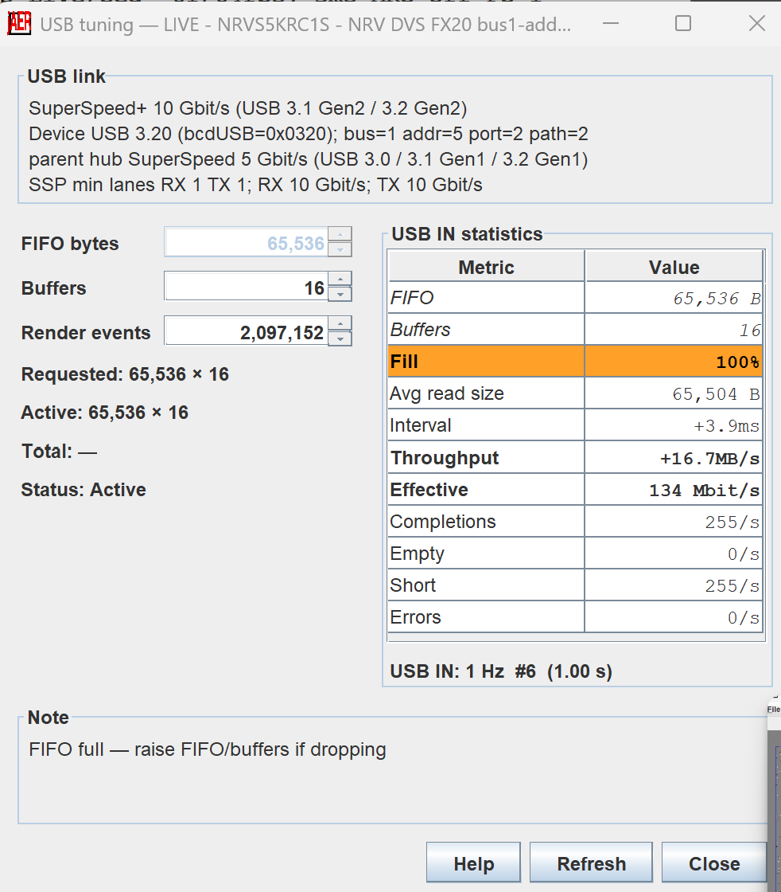
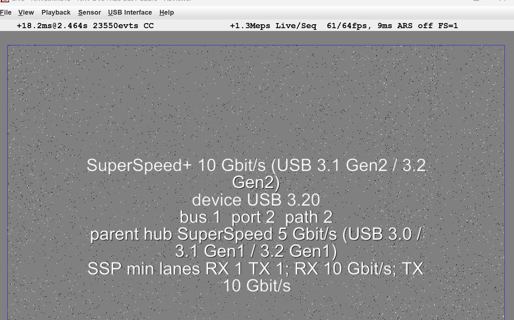
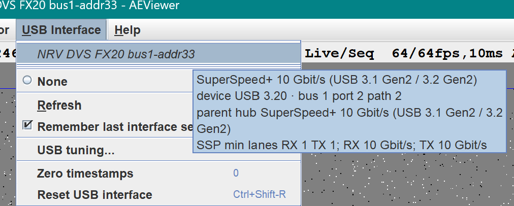
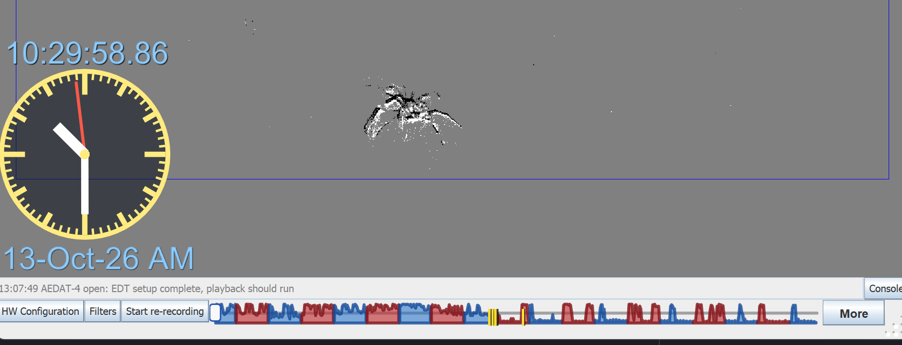

<!--
  Paste-ready for the GitHub prerelease 3.7.0-rc.0. The Release workflow
  requires this filename (jaer-<public>-release-notes.md) and VERSION.txt
  equal to 3.7.0 (the public number, without -rc.0).

  Download links point at tag 3.7.0-rc.0. Installer filenames use 3_7_0.
  Tag 3.7.0-rc.0 is already published from an earlier commit. Long-recording
  work below is on master after that tag. Before the next tag
  (3.7.0-rc.1 or public 3.7.0), retarget the download URLs to that tag.
  Before tagging public 3.7.0, also drop the release-candidate wording.
  Install steps stay the website guide.
  Image links use raw.githubusercontent.com so they render in the Release body.
-->

**jAER 3.7.0-rc.0** is a release candidate after **[3.6.2](https://github.com/SensorsINI/jaer/releases/tag/3.6.2)**. It ships **libusb 1.0.30** (usb4java 1.3.1) on Windows, macOS, and Linux so cameras can be opened on each platform before 3.7.0 is published. **Latest** and **Help → Check for release updates** stay on 3.6.2. winget and Homebrew stay on 3.6.2.

jAER had been using usb4java and libusb4java libraries dated 2018. The major change in this release is updating USB support to cover USB 3.1 and USB 3.2 up to 20Gbps device links.

Long AEDAT-4 recordings reopen from the saved index. A file longer than 12 hours colors the event-rate slider by local day and night, and durations past a day are shown in days, weeks, months, and years.

## Download

| You have | CPU | Download |
|---|---|---|
| Windows 10 / 11 | x64 | [jAER_windows-x64_3_7_0.exe](https://github.com/SensorsINI/jaer/releases/download/3.7.0-rc.0/jAER_windows-x64_3_7_0.exe) |
| macOS | Apple Silicon (M1–M4) | [jAER_macos_aarch64_3_7_0.dmg](https://github.com/SensorsINI/jaer/releases/download/3.7.0-rc.0/jAER_macos_aarch64_3_7_0.dmg) |
| macOS | Intel | [jAER_macos_3_7_0.dmg](https://github.com/SensorsINI/jaer/releases/download/3.7.0-rc.0/jAER_macos_3_7_0.dmg) |
| Linux | x64 | [jAER_unix_3_7_0.sh](https://github.com/SensorsINI/jaer/releases/download/3.7.0-rc.0/jAER_unix_3_7_0.sh) |
| Linux | x64 `.deb` | [jAER_linux-amd64_3_7_0.deb](https://github.com/SensorsINI/jaer/releases/download/3.7.0-rc.0/jAER_linux-amd64_3_7_0.deb) |
| Any OS | Sample data (~995 MB) | [jaer-sample-data.zip](https://github.com/SensorsINI/jaer/releases/download/3.7.0-rc.0/jaer-sample-data.zip) ([README](https://github.com/SensorsINI/jaer/blob/master/jaerSampleData/README.md)) |

Each installer includes a bundled [Eclipse Temurin](https://adoptium.net/) JDK 25. You do not install Java yourself. GitHub lists the same files again under **Assets**. These links work after the `3.7.0-rc.0` Release workflow finishes. The same files are also listed under **Download Prerelease** on [jaerproject.org](https://jaerproject.org/).

Install, update, and uninstall steps are in the **[Install Guide](https://jaerproject.org/install/)**.

An upgrade from 3.6.2 deletes leftover `usb4java-1.3.0` and `libusb4java-1.3.0` jars. If both 1.3.0 and 1.3.1 remain in the install folder, the launcher loads 1.3.0.

## Testers of this release candidate, please test

If there are any observed problems with this release, please file a git issue.

Open a camera, stream, close it, then unplug and plug it back in. Any of these is useful. More than one is better.

- USB 2: DVS128, DAVIS, or a Silicon Labs board
- USB 3 SuperSpeed (5 Gbit/s): Cypress FX3, Prophesee, or NRV
- USB 3.2: Delta10 FX20. A 10 Gbit/s port should log SuperSpeed+ 10 Gbit/s. A two-lane Gen 2×2 port should log SuperSpeed+ 20 Gbit/s

On startup the log should name **libusb 1.0.30**, either `LibUsb hotplug event pump started (libusb 1.0.30)` or `LibUsb hotplug not supported (libusb 1.0.30)`. On open, the INFO line `USB link:` should name the negotiated speed. SuperSpeed and faster cameras also append `SSP min lanes RX … TX …` and each direction’s rate (for example `10 Gbit/s`). That text is on the USB tuning dialog, the chip overlay, and the USB Interface tooltip. A USB 2 camera still opens when the SuperSpeedPlus descriptor is absent; that miss is logged at FINE.

When the hotplug line says the event pump started, the USB Interface menu should update from plug events. When it says hotplug is unsupported, discovery keeps the periodic bus scan. Windows with libusb 1.0.22 used that scan. Please say which line you got, and whether plug and unplug still refresh the menu.

WinUSB setup is unchanged for cameras that already needed Zadig.

With the jAER log already at FINE before the first camera factory starts, `%TEMP%\jaer\jAER-0.log` (or the platform temp `jaer` folder) should contain `libusb:` lines. A healthy stream stays quiet at FINE. FINER adds libusb debug.

The jars also contain Linux ARM, Linux aarch64, 32-bit Linux, and 32-bit Windows natives for a source checkout. The installers above are Windows x64, macOS Intel, macOS Apple Silicon, and Linux x64.

## New in this candidate

1. [libusb 1.0.30](#libusb-1030)
2. [USB link rates](#usb-link-rates)
3. [One USB Interface menu](#usb-interface-menu)
4. [Day and night on the scrubber](#day-night)
5. [Durations past a day](#long-durations)
6. [Opening a multi-day file](#long-index)

<h3 id="libusb-1030">libusb 1.0.30</h3>

jAER 3.6.2 bundled libusb 1.0.22 (October 2018) through usb4java 1.3.0. This candidate bundles SensorsINI usb4java 1.3.1, built against libusb 1.0.30 (May 2026). The native libraries cover macOS Intel and Apple Silicon, Linux x86-64, x86, ARM, and aarch64, and Windows x64 and x86. Windows x64 and x86 are the Visual Studio builds.

The new JNI runs only when `LibUsb.getVersion()` is 1.0.30 or newer. WinUSB RAW_IO stays off.

<h3 id="usb-link-rates">USB link rates</h3>

Opening a SuperSpeed or faster camera reads the SuperSpeedPlus capability (1 second control-transfer timeout) and appends minimum lane counts and each direction’s rate. libusb 1.0.30 adds speed code 6, **SuperSpeed+ 20 Gbit/s (USB 3.2 Gen2x2)**. Speed code 5 remains **SuperSpeed+ 10 Gbit/s**. A 10 Gbit/s port can be Gen 2×1 or Gen 1×2; the lane line is the one that names the trained rates. The Delta10 FX20 opens with the shipped NRV bias preset and logs its bulk IN endpoint.

The same text is on the USB tuning dialog and on the chip view. This Delta10 trained at 10 Gbit/s on a port whose parent hub is 5 Gbit/s. Fill is orange at 100%, with the note to raise FIFO or buffers if events are dropping.

<h3 id="usb-interface-menu">One USB Interface menu</h3>

The Interface and USB menus are a single **USB Interface** menu. **Biases/HW Configuration** is the first item on the **Sensor** menu, above the sensor list. **Reset USB interface** and **Zero timestamps** sit in their own section at the bottom of USB Interface, with **USB tuning** just above them. Hovering the open camera shows the same link line.

Prophesee uses **Render events** as its only per-frame cap, the same control as NRV. The separate Live keep setting is gone.

## Long recordings

<h3 id="day-night">Day and night on the scrubber</h3>

A recording longer than 12 hours paints the event-rate slider **blue** for local daytime and **red** for night. Day is 06:00–18:00 in the file’s time zone. A file of 12 hours or less stays a single blue histogram. The clock on the chip view is the playback time.

<h3 id="long-durations">Durations past a day</h3>

The recording overlay uses a compact duration. Under a day that is still `1h5s` or `1m37s`. At a day or more it leads with the largest unit that fits: `6d`, `2w1d`, `1mo6d`, `2y3mo6d13h`. Weeks are used under a month. **mo** is months, so it stays distinct from minutes (**m**). The disk auto-stop estimate also runs through years (`1y 2mo`). ([fcc38313c](https://github.com/SensorsINI/jaer/commit/fcc38313c))

Minimizing the viewer during a background recording skips chip painting. Acquisition, filters, recording, UDP, ROS 2 / Foxglove, and DNN shared memory keep running. Painting stays on when OpenCV is publishing the chip view or an AVI capture is active. ([52be47764](https://github.com/SensorsINI/jaer/commit/52be47764))

<h3 id="long-index">Opening a multi-day file</h3>

The packet index cache now accepts 64 million packets. A 221-hour file of about 29 million packets reopens with `Reading cached AEDAT-4 index` instead of decompressing every packet. The old cap was 10 million, which rejected that cache on every open. ([c2bb76650](https://github.com/SensorsINI/jaer/commit/c2bb76650))

A FileDataTable that does not fit in one FlatBuffer (about 2 GiB, past roughly 40 million rows) is stored as an **FTCH** directory plus one compressed chunk per 8 million rows. Record, merge, and the LZ4 re-recorder write that form, and open shows progress across every chunk and the in-memory index. New recordings close a polarity row every 100 ms of event time, or at 1,048,576 events, so a week of capture stays one table. Frames and IMU are not delayed to that window. An older file with a single table still opens. ([717a6c6e3](https://github.com/SensorsINI/jaer/commit/717a6c6e3))

**File → Show file info** sums the payload sizes already stored on that index. It does not seek a codec header in every packet. ([ab9daf7f7](https://github.com/SensorsINI/jaer/commit/ab9daf7f7))

## Also since 3.6.2

- The sensor chooser remembers the last chip for a camera when the host assigns a new USB bus address. ([2f434c263](https://github.com/SensorsINI/jaer/commit/2f434c263))
- **ApproachCell** and **ObjectMotionCell** are in the filter list and stay off unless **Enable filters on startup** restores a saved enabled state. ([4b0f7aa2a](https://github.com/SensorsINI/jaer/commit/4b0f7aa2a))
- WitMotion can draw rate-gyro vectors under the compass. **gyroScaleDps** sets the deg/s that reaches the disk rim.
- The playback direction overlay names **Forward** or **Reverse** after **b** or Toggle playback direction. ([b3303630d](https://github.com/SensorsINI/jaer/commit/b3303630d))
- NmeaGnssFilter can dial the phone Wi-Fi hotspot. Leave **host** empty, turn **hotspotGateway** on, and jAER uses the Wi-Fi gateway. gpsdRelay stays on `0.0.0.0:2947`. The filter help is the order that sends a fix: TCP, the row switch, NMEA generation, play, then Maps. ([514c85889](https://github.com/SensorsINI/jaer/commit/514c85889))

## Bug fixes

1. Installing over 3.6.2 removes leftover usb4java 1.3.0 jars so the 1.0.30 library is the one that loads. ([bf2bab2cf](https://github.com/SensorsINI/jaer/commit/bf2bab2cf))
2. A paused 3-D view no longer copies APS frames on every redraw. A long pause on a multi-frame packet was filling the heap. ([adf886ffc](https://github.com/SensorsINI/jaer/commit/adf886ffc))
3. Save As on a long AEDAT-4 recording stays responsive: prep progress is shown, the time estimate starts after events are written, and cancel deletes the partial file. ([898e3816c](https://github.com/SensorsINI/jaer/commit/898e3816c))
4. The sleep-recording dialog accepts Yes while a long recording is open. The view loop waits for the choice instead of holding the OpenGL thread inside the dialog. ([983717b56](https://github.com/SensorsINI/jaer/commit/983717b56))
5. Exporting a video asks before replacing an existing file. Cancel leaves the files unchanged. The intermediate AVI is deleted after a successful MP4. ([71b3f68b5](https://github.com/SensorsINI/jaer/commit/71b3f68b5))
6. Merging a VCR deck keeps the playback histogram when a cassette was still open. ([0195e56a2](https://github.com/SensorsINI/jaer/commit/0195e56a2))
7. The first open of an FX20 loads the Delta10 bias preset. A CX3 settings file programs a PLL that does not stream on this bridge, and a USB reset does not undo that write. ([86812a126](https://github.com/SensorsINI/jaer/commit/86812a126))
8. A missing camera calibration is logged at FINE. A calibration file with a bad format is still a warning. ([5d94df9af](https://github.com/SensorsINI/jaer/commit/5d94df9af))
